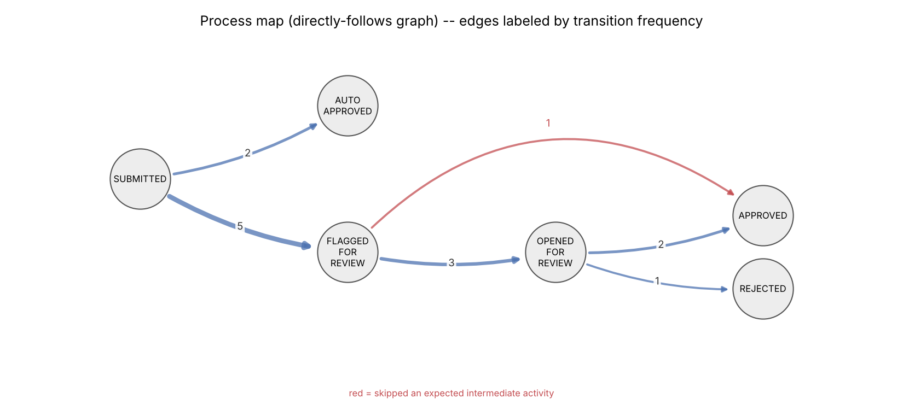
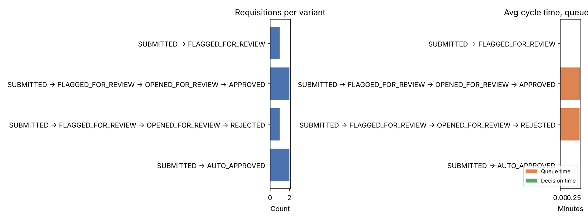

# ReqFlow Process Intelligence -- Proof-of-Value Summary

> Sample output from a small local demo run (7 hand-created requisitions, including one deliberately approved via a direct API call that skips the expected `/open` step, specifically so the conformance check below has a real deviation to catch rather than reporting a clean pass that's never actually been tested), checked in to show the report's shape -- the process map, variants, the queue/decision split, the reviewer breakdown, department cut, and conformance. Run against real usage, the same fields populate at whatever volume and cadence the process actually runs at, and the at-scale projection below shows how the same rate reads at a disclosed, hypothetical production volume.

Scope: 7 requisitions currently in the system.

## Process map

## Variants (actual activity sequences)

| Variant | Count | Share | Avg total | Avg queue | Avg decision |
|---|---:|---:|---:|---:|---:|
| SUBMITTED → AUTO_APPROVED | 2 | 29% | 0.0 min | -- | 0.0 min |
| SUBMITTED → FLAGGED_FOR_REVIEW → OPENED_FOR_REVIEW → APPROVED | 2 | 29% | 0.4 min | 0.4 min | 0.0 min |
| SUBMITTED → FLAGGED_FOR_REVIEW → OPENED_FOR_REVIEW → REJECTED | 1 | 14% | 0.4 min | 0.3 min | 0.0 min |
| SUBMITTED → FLAGGED_FOR_REVIEW | 1 | 14% | -- | -- | -- |
| SUBMITTED → FLAGGED_FOR_REVIEW → APPROVED | 1 | 14% | 0.0 min | -- | 0.0 min |

*Queue/decision only populate for cases with an explicit `OPENED_FOR_REVIEW` event -- without one, only the total is reportable, disclosed rather than interpolated.*

## All flagged cases, by original flag reason (decided or still open)

| Reason | Count |
|---|---:|
| Vendor risk too high / inactive | 3 |
| Budget headroom insufficient or untracked | 1 |
| Amount over auto-approval ceiling | 1 |

*1 case(s) still awaiting a decision; average age 23.7 min.*

## Decisions by reviewer

| Reviewer | Decisions |
|---|---:|
| agent:claude-triage-v1 | 3 |
| system:auto-approval-policy | 2 |
| direct-test-reviewer | 1 |

*Human name or `agent:claude-triage-v1` -- a cheap organizational-mining cut (who's deciding what) over a field (`decidedBy`) the API already carries.*

## Avg total cycle time by department

| Department | Cases | Avg total |
|---|---:|---:|
| Operations | 1 | 0.4 min |
| Facilities | 3 | 0.2 min |
| Engineering | 2 | 0.0 min |

*Illustrative only at this sample size -- a real engagement would need far more cases per department before reading a difference as a finding rather than noise.*

## Conformance check

Checked against the expected control flow: every case starts with `SUBMITTED`, and a flagged case that reaches a decision is expected to have been opened for review first. The API doesn't enforce that ordering -- `approve`/`reject` only require `PENDING_REVIEW` status, not a prior `OPENED_FOR_REVIEW` event -- so a deviation here is real data, not a bug.

**1** case(s) deviated from the expected flow:

- requisition 7: Decided without ever being opened for review (bypassed the expected flag -> open -> decide path)

## Estimated business value

- **2** requisitions were auto-approved and never reached a human reviewer.
- At an assumed **8 min/case** manual review time, that's **~0.27 reviewer-hours** avoided.
- At an assumed **$25/hr** reviewer cost, that's **~$6.67** avoided.

*Assumptions are disclosed and swappable -- a real engagement would substitute the customer's own review-time and labor-cost figures.*

At the same **29%** auto-approval rate but a production volume of **2,000/month** (disclosed, hypothetical): **~571** auto-approved, **~76.1 reviewer-hours** and **~$1,903/month** avoided.

